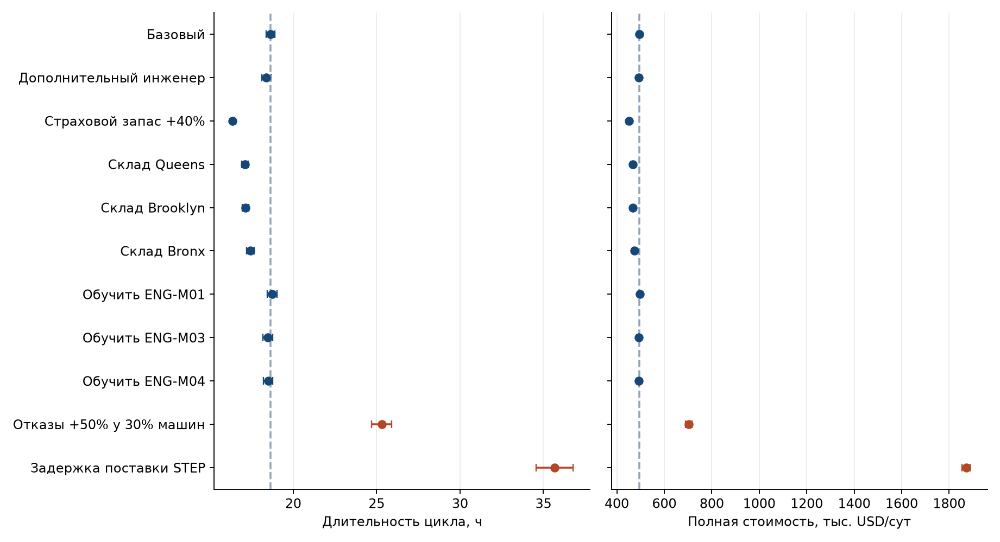

# Сервисная логистика эскалаторов метро Нью‑Йорка

Учебный проект по оптимизации логистики на Python. На примере **216 эскалаторов NYCT** я исследую, что быстрее и дешевле сокращает простой: увеличенный запас комплектов, дополнительный инженерный пост или второй склад. Модель связывает транспортный граф, очереди, запасы и квалификацию исполнителей и позволяет проверить решение до изменения ресурсов.

**Основной результат:** в условиях модели увеличение уровней запаса на 40% оказалось выгоднее найма. По сравнению с базовым сценарием средний цикл восстановления сократился **с 18,64 до 16,36 часа**, а готовность выросла **с 85,19% до 86,74%**.

[Результаты по сценариям](results/coursework/scenario_comparison.csv) · [95%-е интервалы по всем показателям](results/coursework/kpi_summary.csv) · [Запуск](#запуск)

## Задачи и подход

1. **Подготовка данных.** Сопоставить реестр оборудования MTA и месячную статистику за 2025 год по коду машины и станции. На 2 359 пригодных наблюдениях оценить интенсивность неплановых отключений с поправкой на разную длительность наблюдения.
2. **Маршрутизация и пропускная способность.** Построить взвешенный граф площадок. Рассчитать кратчайший путь Дейкстрой и проверить его алгоритмом Беллмана — Форда. Вычислить максимальный поток минимальной стоимости, проверить ёмкости и балансы, выделить региональные группы методом Louvain.
3. **Моделирование операций.** Описать цикл от отказа до восстановления: назначение инженера, выезд, диагностика, резерв комплекта, доставка и ремонт. Вероятности переходов зависят от остатков, свободных инженерных постов и загрузки склада. Контрольную модель одной машины сверить аналитически с 24 000 имитационных циклов.
4. **Сравнение решений.** Выполнить **11 сценариев × 24 прогона** с общими случайными числами для парных сравнений. Оценить время цикла, готовность, загрузку, частоту дефицита и стоимость; сохранить журналы и 95%-е доверительные интервалы.

## Результаты

| Сценарий | Средний цикл, ч | Готовность | Затраты, тыс. модельных USD/сут |
| --- | ---: | ---: | ---: |
| Базовый | 18,64 | 85,19% | 495,8 |
| Дополнительный инженерный пост | 18,39 | 85,36% | 492,8 |
| Увеличение уровней запаса на 40% | **16,36** | **86,74%** | **452,5** |
| Второй склад в Queens | 17,10 | 86,22% | 467,3 |
| Обучение поста ENG‑M03 | 18,49 | 85,30% | 492,9 |

- **Запас или найм.** При заданных затратах вариант с запасом дешевле найма в среднем на 40,3 тыс. модельных USD/сут (парный 95%-й ДИ: 35,2–45,3 тыс.). Доля завершённых циклов с дефицитом снизилась с 19,33% до 0,75% относительно базового сценария.
- **Склад и обучение.** Queens и ENG‑M03 лидируют по средним затратам в своих группах, но парные интервалы разницы с ближайшими вариантами — Brooklyn и ENG‑M04 — включают ноль.
- **Узкие места.** В транспортной проекции — 62 площадки и шесть региональных групп. Поток ограничен 489 комплектами в неделю при расчётной потребности 638. Стресс-тесты показывают, как рост отключений и задержка пополнения меняют очереди и готовность.



[Транспортный граф и контрольный маршрут](results/coursework/figures/network.png) · [Региональные группы и критические площадки](results/coursework/figures/clusters.png) · [Парные сравнения](results/coursework/paired_policy_comparisons.json)

## Практическая ценность

Граф позволяет отделить географию и ограничения перевозки от ожидания персонала и дефицита: самый короткий маршрут сам по себе не устраняет очередь к ресурсу. Подход применим к планированию логистики: формализовать ограничения, проверить маршрут и поток, объяснить отклонения через журнал событий и сравнить сценарии по стоимости и качеству сервиса.

**Границы модели.** Реальные наблюдения — [реестр оборудования MTA](https://data.ny.gov/d/94fv-bak7) и [месячные данные об отключениях и доступности](https://data.ny.gov/d/rc78-7x78). Транспортные времена, штат, запасы и цены заданы как допущения. Затраты и эффекты — оценки внутри модели, а не фактические показатели MTA. Маршрутизация здесь решает задачу кратчайшего пути и потока, без моделирования курьерских рейсов с тайм-слотами.

## Структура

| Путь | Что посмотреть |
| --- | --- |
| [`src/model_g.py`](src/model_g.py) | Подготовка истории в pandas, предметный граф, маршруты, потоки и кластеры. |
| [`src/model_h.py`](src/model_h.py), [`src/simulation.py`](src/simulation.py) | Вероятностные переходы, аналитическая проверка и симуляция заявок. |
| [`src/coursework.py`](src/coursework.py), [`src/figures.py`](src/figures.py) | Запуск сценариев, сводка, доверительные интервалы и графики. |
| [`config/`](config/) | Сценарии, диапазоны и модельные параметры. |
| [`source/`](source/), [`data/`](data/) | Снимки MTA и запрос, словари, оценки интенсивности и предметный граф. |
| [`tests/`](tests/) | pytest: крайние случаи вероятностей, марковский эталон, маршрут и поток, воспроизводимость и балансы ресурсов. |
| [`results/coursework/`](results/coursework/) | KPI, графики, семена, журналы и машинные результаты. |

## Запуск

Модель проверена на **Python 3.12**. Основной стек: **pandas, NumPy, SciPy, NetworkX, Matplotlib, pytest**.

```bash
git clone https://github.com/Danyets-los/portfolio.git
cd portfolio/nyct-escalator-logistics
python -m pip install -r requirements.txt
python run_coursework.py --quick
```

Быстрый запуск выполняет тесты и сокращённый эксперимент, сохраняя его отдельно в `results/quick/`. Для полного воспроизведения таблиц и графиков запустите `python run_coursework.py`. Снимки данных включены: после установки зависимостей сеть не нужна.

Данные предоставлены MTA через портал штата Нью‑Йорк на условиях [OPEN-NY Terms of Use](https://data.ny.gov/dataset/OPEN-NY-Terms-Of-Use/77gx-ii52).
